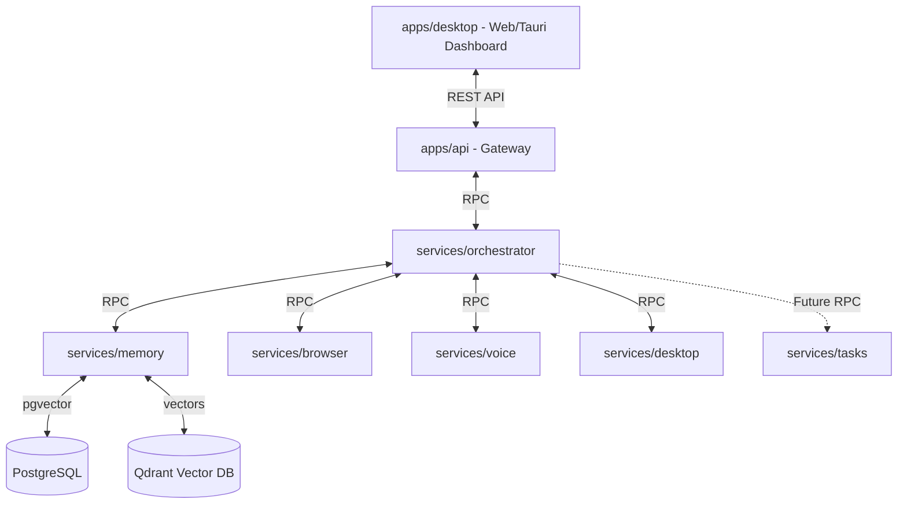
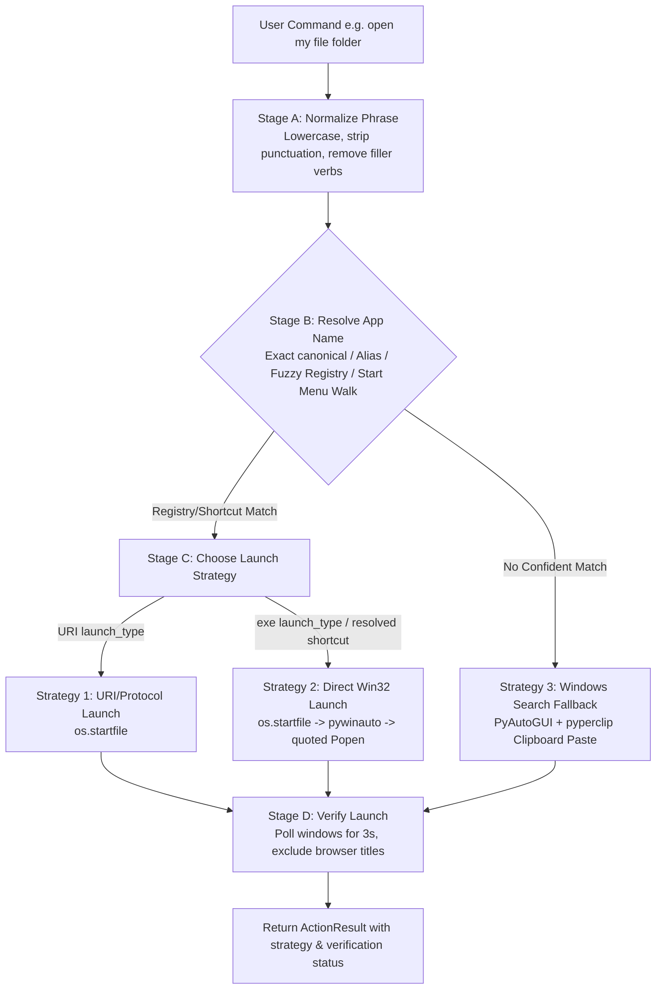
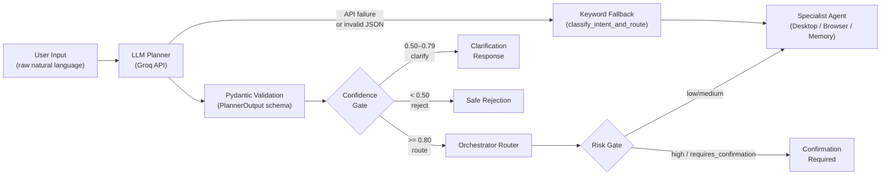
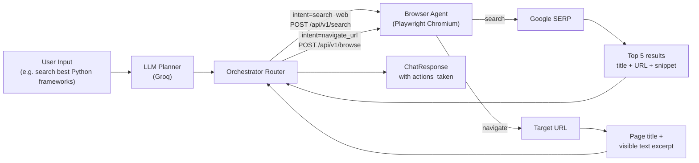

# JARVIS Architecture

This document describes the architectural principles, component design, security profiles, and extension patterns for **Project JARVIS**.

---

## Central Design Principles

### 1. Local-First Strategy
JARVIS is designed to run directly on the user's local workstation. All primary data processing, context indexing, state management, and orchestration are carried out within local Docker containers or system binaries.
- **Privacy Preservation**: User commands, browser sessions, documents, and transcripts never leave the machine unless explicitly allowed by the user.
- **Zero Cloud Reliance**: Basic assistant coordination, local vector DB retrieval, and document parsers function completely offline.
- **Low-Latency Loop**: Running LLM inference and speech adapters on local machine eliminates round-trip latencies associated with external servers.

### 2. Centralized Coordinator (Orchestrator-Centered)
To avoid chaotic agent behaviors, JARVIS employs a strict **Hub-and-Spoke Orchestrator Architecture**.



* **Gateway (apps/api)**: Acts as the public proxy, handling token authentication, rate-limiting, and aggregate health metrics.
* **Orchestrator (services/orchestrator)**: The "brain" of the agent. It receives queries, decomposes them into structural sub-tasks, requests context from the Memory service, dispatches tasks to specialized workers, and compiles responses.
* **Specialized Services**: Microservice agents (browser, voice, memory, desktop) are simple, focused workers with no knowledge of each other. They interact solely via standardized Pydantic API contracts.

---

## Agent Modularity

Each service is a self-contained container, communicating over HTTP/gRPC. Adding a new capability involves:
1. Defining the schema contracts in `shared/contracts/`.
2. Implementing a microservice exposing a `/healthz` endpoint and the schema routes.
3. Adding the service definition to the root `docker-compose.yml`.
4. Registering the service and port inside `shared/config/settings.py` so the gateway and orchestrator can locate it.

---

## Security & Permission Model

Since JARVIS runs locally and controls desktop tools (like browser drivers, filesystem execution), it requires a robust security framework. System tools are categorized into three risk tiers:

| Risk Level | Actions | Security Controls | User Interaction Required |
| :--- | :--- | :--- | :--- |
| **Low Risk** | Voice generation, local reading of public logs, database lookups | Encrypted credentials, TLS localhost traffic | **None** (Silent execution) |
| **Medium Risk** | Web scraping, writing to conversation logs, reading non-system local files | Headless isolation, directory path restrictions | **One-time consent** or session-level allowance |
| **High Risk** | Executing code scripts, modifying host system files, web page form submission | Sandboxed runtime (e.g. gVisor, WebAssembly, or Docker runtime isolation) | **Explicit approval per action** with preview of command |

### Sandboxed Code Execution
The future `services/code` execution node runs code compiled or written by the agent. It is completely isolated from the host machine's filesystem to prevent destructive operations.

---

## Future Plugin Support

Third-party integrations (e.g., controlling Spotify, accessing local calendar, scraping proprietary APIs) will plug in through a standardized event handler bus:
- **WebSocket Subscriptions**: Plugins subscribe to Orchestrator event channels.
- **Dynamic Tool Injection**: The Orchestrator polls an registry folder (e.g. `shared/plugins/`) at startup to read capabilities metadata and injects them as tools into the LLM context.

---

### Desktop Automation & Application Resolution Layer
 
To enable human-like interaction with Windows desktop applications, the **Desktop Agent** (`services/desktop`) implements a deterministic 4-stage execution pipeline.



### 1. Stage A: Natural Language Normalization
User commands are normalized by:
* Lowercasing and collapsing repeated spaces.
* Stripping standard punctuation.
* Normalizing separators like `_` and `-` into spaces.
* Removing filler command verbs and wrappers (`open`, `launch`, `start`, `show`, `bring up`, `pop up`, `open up`, `run`) using regex word boundaries to prevent corruption of words containing similar sub-phrases (e.g., preserving `"whatsapp"` or `"settings"`).

### 2. Stage B: App Name Resolution
The agent resolves the normalized phrase against a structured registry and local shortcuts:
* **Structured APP_REGISTRY**: Mappings contain `canonical` name, `aliases` (list), `launch_type` (`uri`/`exe`), `target` command/protocol, and `title_hints` (for window verification).
* **Exact & Alias Matching**: Checks canonical and alias fields. If found, returns matches as `exact_match` or `alias_match`.
* **Fuzzy Matching**: Matches Registry entries using python's `difflib.SequenceMatcher`. A similarity score `>= 0.70` (70%) is accepted as a `fuzzy_match`.
* **Start Menu / Shortcut Walk**: If not in the registry, the agent scans `.lnk` shortcuts in user/system Start Menu folders (`%APPDATA%` and `%ProgramData%`) looking for exact, spaceless, or fuzzy matches.
* **Search Fallback**: If no local shortcut or registry match exists, it registers the query as `search_fallback`.

### 3. Stage C: Launch Strategy Hierarchy
* **Strategy 1: URI/Protocol Launch**: Used when `launch_type` is `"uri"` (e.g. `ms-settings://`, `ms-copilot://`). It attempts to launch it using Windows `ShellExecute` via `os.startfile(uri)`.
* **Strategy 2: Direct Win32 Launch**: Used when `launch_type` is `"exe"` or for unregistered applications resolved on disk. It tries:
  1. `os.startfile(path)` (robust launch for shortcuts/executables with spaces in paths).
  2. `pywinauto.Application().start(path)` as a fallback.
  3. `subprocess.Popen(f'"{path}"', shell=True)` with double quotes around the path.
  4. Registry fallback running raw command (e.g. `notepad.exe`) if file resolution failed.
* **Strategy 3: Windows Search Fallback**: Triggered for unrecognized applications or failed direct launches. It uses PyAutoGUI to invoke Windows Search (`Win + S`), copies the search term to the clipboard via `pyperclip` (to bypass caps lock or layout keyboard states), and pastes it (`Ctrl + V`).

### 4. Stage D: Launch Verification
Once launched, the agent runs window verification:
* It polls the desktop windows list using `pywinauto` up to 6 times over 3 seconds.
* It excludes web browser titles (unless the requested application is Chrome, Edge, etc.) to prevent false positives from active search tabs.
* It searches for `title_hints` or resolved app name aliases in open window titles.
* Returns an `ActionResult` including:
  * `success`: Boolean indicating if launch was executed.
  * `launch_strategy`: The explicit choice (e.g., `Direct path launch (os.startfile)`).
  * `verification_status`: Status indicator (`verified_window`, `window_not_verified`, etc.).

---

## LLM Planner / Refiner Layer (Phase 2, Chunk 5)

### Overview

Before any specialist agent receives a task, raw user input passes through an **LLM Planner / Refiner Layer** powered by Groq. The planner converts casual natural language into a strict Pydantic-validated JSON task object.

> **Critical distinction**: The planner is **reasoning-only**. It never calls desktop tools, browsers, or any execution layer. All real actions remain in deterministic specialist agents.

### Architecture Flow



### Reasoning vs. Execution Separation

| Layer | Responsibility | Can execute actions? |
|---|---|---|
| **LLM Planner** (`planner_service.py`) | Interpret user intent, structure as JSON | ❌ Never |
| **Orchestrator Router** (`main.py`) | Apply confidence/risk gates, route validated task | ❌ No direct tool calls |
| **Desktop Agent** (`services/desktop/main.py`) | Deterministic execution of structured tasks | ✅ Yes |
| **Browser Agent** (`services/browser/main.py`) | Deterministic web automation | ✅ Yes |

### Confidence Threshold Logic

| Confidence | Behaviour |
|---|---|
| `>= 0.80` | Route task to specialist agent normally |
| `0.50 – 0.79` | Return a clarification request; ask user to rephrase |
| `< 0.50` | Safely reject with a helpful guidance message |

Thresholds are configurable via environment variables:
- `PLANNER_CONFIDENCE_ROUTE` (default: `0.80`)
- `PLANNER_CONFIDENCE_CLARIFY` (default: `0.50`)

### Risk Classification (Planner Output)

| `risk_level` | Examples | `requires_confirmation` |
|---|---|---|
| `low` | open app, open folder, screenshot, search web | `false` |
| `medium` | close app, system control, browse web | `false` (warning logged) |
| `high` | delete, uninstall, format, shutdown, credential access | `true` (execution blocked) |

### Graceful Degradation

If `GROQ_API_KEY` is missing or the Groq call fails after retries, the orchestrator automatically falls back to the existing **keyword-based `classify_intent_and_route()`** function. This ensures the system **never fully breaks** when the LLM planner is unavailable.

The planner failure and fallback are both recorded in `actions_taken` for full observability.

### Planner Output Schema (`PlannerOutput`)

```json
{
  "schema_version": "1.0",
  "raw_user_input": "open downloads folder",
  "intent": "open_folder",
  "target_agent": "desktop",
  "action": "open",
  "target": "downloads",
  "parameters": {},
  "confidence": 0.96,
  "requires_confirmation": false,
  "risk_level": "low",
  "reasoning_summary": "User wants to open the downloads folder on the desktop."
}
```

### Prompt Version Tracking

Every planner call logs `planner_prompt_version` (currently `"1.0"`) alongside `model_name` and `schema_version` in the task's `planner_metadata` field. This enables future A/B testing of prompt improvements without changing the execution layer.

### Configuration

| Environment Variable | Default | Description |
|---|---|---|
| `GROQ_API_KEY` | *(required)* | Groq API key for LLM calls |
| `GROQ_MODEL` | `llama-3.3-70b-versatile` | Groq model identifier |
| `PLANNER_CONFIDENCE_ROUTE` | `0.80` | Minimum confidence to route normally |
| `PLANNER_CONFIDENCE_CLARIFY` | `0.50` | Minimum confidence to request clarification |

---

## Browser Agent Execution Layer (Phase 2, Chunk 6)

### Overview

The Browser Agent (`services/browser`) has been upgraded from a mock/stub to a **real headless Chromium execution layer** powered by [Playwright](https://playwright.dev/python/). It handles two primary intents routed by the orchestrator:

- `search_web` → Google SERP scrape returning structured results (title + URL + snippet)
- `navigate_url` / `browse_web` → Navigate to a URL and return page title + visible text excerpt
- `screenshot` → Capture a full-page screenshot, save to disk, return path

### Execution Flow



### Orchestrator Dispatch Logic

The orchestrator's `run_task_execution()` selects the browser endpoint based on `task.intent`:

| `task.intent` | Browser endpoint | Payload |
|---|---|---|
| `search_web`, `search` | `POST /api/v1/search` | `{query, max_results: 5}` |
| `navigate_url`, `browse_web`, `navigate` | `POST /api/v1/browse` | `{action: "navigate", url}` |
| other | `POST /api/v1/browse` | `{action: intent, url}` |

HTTP timeout is **25 seconds** (Playwright startup + page load).

### Browser Agent Endpoints

| Endpoint | Description |
|---|---|
| `GET /healthz` | Liveness — always returns `healthy` |
| `GET /readyz` | Readiness — validates Playwright Chromium binary is installed |
| `POST /api/v1/search` | Google search, returns `BrowserSearchResponse` |
| `POST /api/v1/browse` | Multi-action endpoint (navigate / search / screenshot) |

### Headless Chromium Launch Flags

```python
args=["--no-sandbox", "--disable-setuid-sandbox", "--disable-dev-shm-usage"]
```

These flags are required for running inside a Docker container without a display server.

### Configuration

| Environment Variable | Default | Description |
|---|---|---|
| `BROWSER_TIMEOUT_MS` | `15000` | Playwright navigation timeout (ms) |
| `BROWSER_NAV_WAIT` | `8000` | Extra wait after page load for JS rendering (ms) |
| `SCREENSHOTS_DIR` | `/app/screenshots` | Directory for saved screenshot files |

### Graceful Degradation

If the Browser Agent container is unreachable or times out, the orchestrator catches the exception, marks the task as `FAILED`, and records the failure in `actions_taken`. The gateway still returns a `200` response with a descriptive error in `response_text` so the frontend always receives a usable reply.
